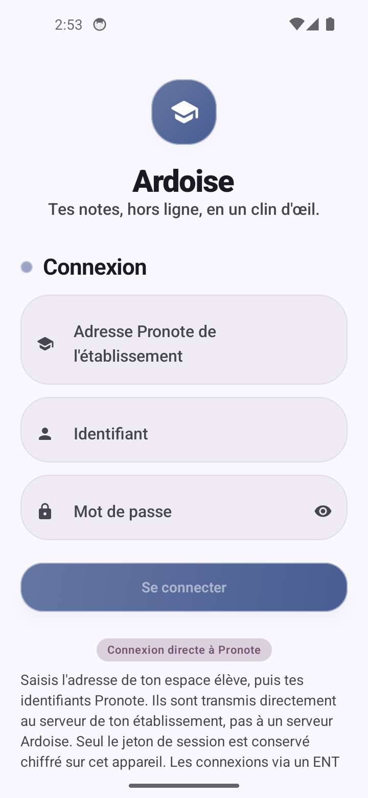
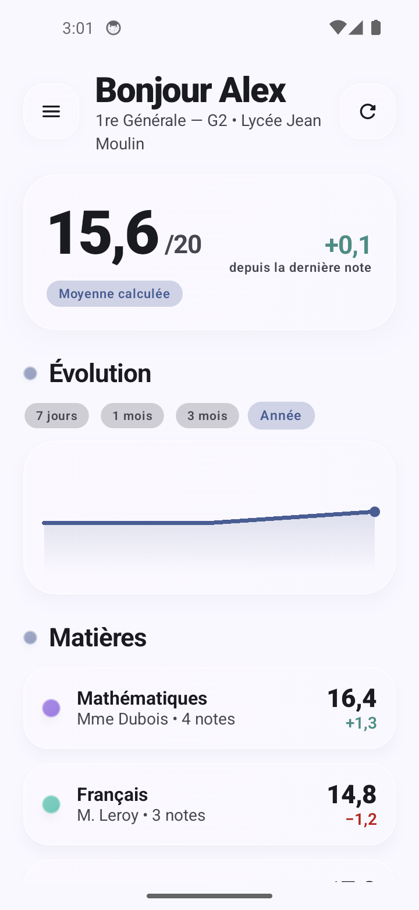
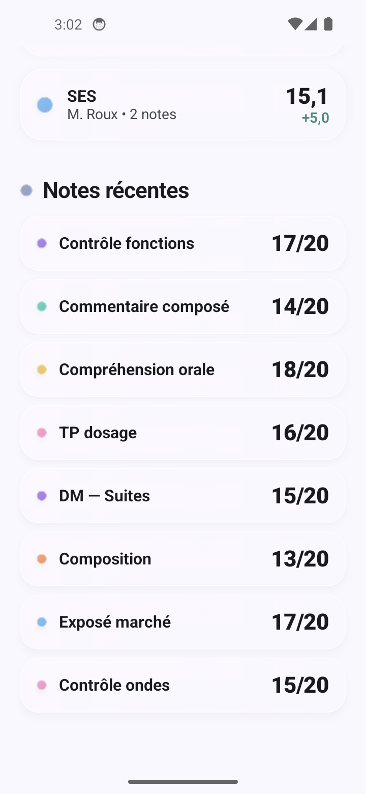
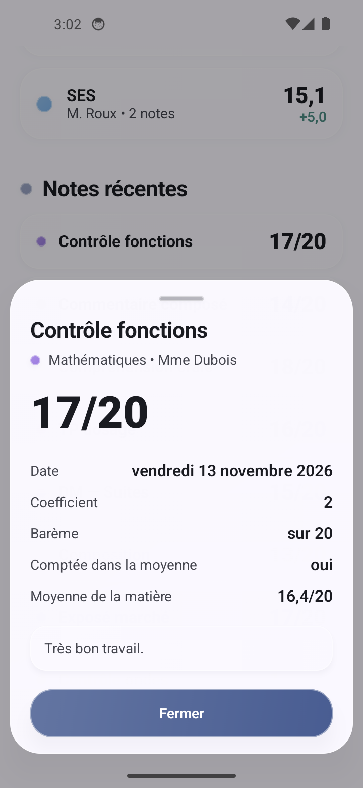
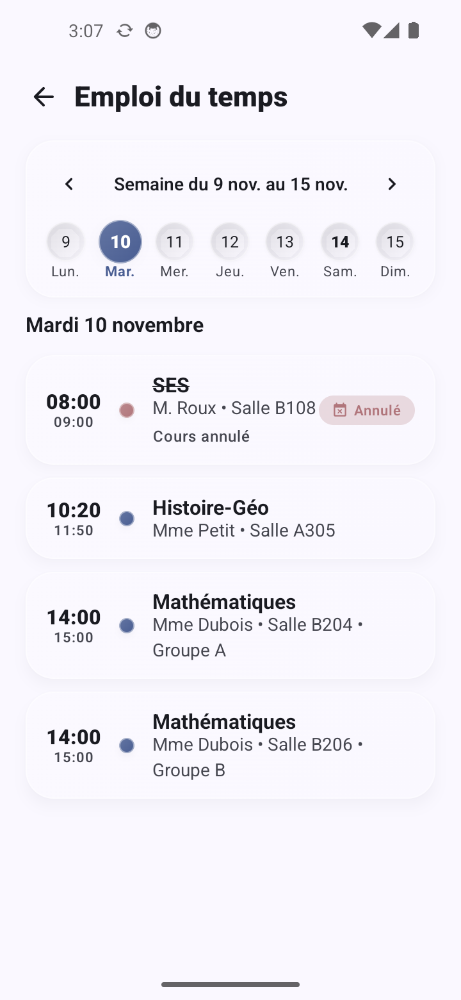
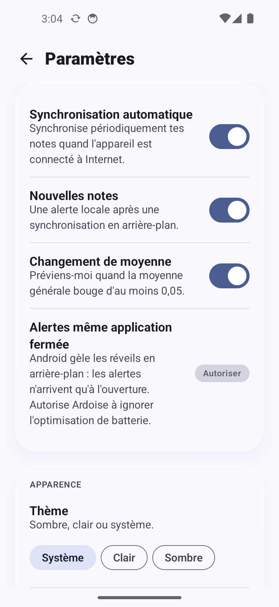
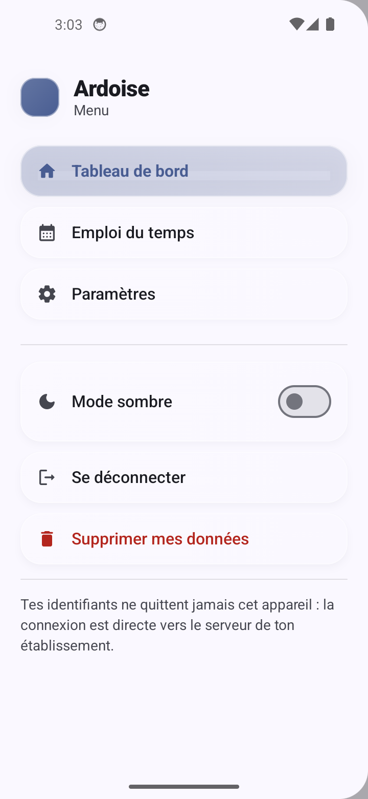

# Ardoise

Tes notes Pronote, enfin lisibles — une application Android légère, hors ligne
d'abord, qui se connecte **directement au serveur de ton établissement**. Aucun
serveur intermédiaire : tes identifiants ne passent jamais par une machine
tierce.

> Ardoise est un client **non officiel**. « Pronote » est une marque
> d'Index-Éducation ; l'application n'est ni éditée ni approuvée par eux.

Page de téléchargement : <https://ardoise.freebuff.page> ·
Version publiée : voir [`CHANGELOG.md`](CHANGELOG.md).

## Captures

Prises sur l'application réelle (émulateur 720×1560) :

| Connexion | Tableau de bord | Notes |
| --- | --- | --- |
|  |  |  |

| Fiche de note | Emploi du temps | Paramètres |
| --- | --- | --- |
|  |  |  |



## Ce que fait l'application

- **Notes et moyennes** — moyenne générale, variation depuis la dernière note,
  courbe d'évolution (7 jours, 1 mois, 3 mois, année), moyenne par matière.
  Chaque note s'ouvre sur une fiche : coefficient, barème, date, appréciation.
- **Emploi du temps** — semaine navigable, cours du jour sélectionné, salles,
  professeurs, groupes parallèles et cours annulés signalés.
- **Hors ligne d'abord** — les dernières données restent consultables sans
  réseau ; la synchronisation reprend au retour de la connexion.
- **Alertes locales** — nouvelles notes et variation de moyenne, calculées en
  arrière-plan environ une fois par heure quand Android l'autorise.
- **Session qui se répare seule** — un jeton expiré est renouvelé et la requête
  rejouée : plus de déconnexion/reconnexion manuelle.
- **Thème clair, sombre ou système**, couleurs Material You, verrouillage
  biométrique.

## Installation

1. Télécharge `Ardoise.apk` depuis le site ou la dernière release GitHub.
2. Android demande d'autoriser l'installation depuis ton navigateur : accepte
   une seule fois.
3. Saisis l'adresse Pronote de ton établissement et tes identifiants élève.
   Les connexions passant par un ENT ne sont pas prises en charge.

Mises à jour : l'app interroge `/version.json` et propose la nouvelle version ;
avec [Obtainium](https://github.com/ImranR98/Obtainium), pointe-la sur
<https://github.com/montecotsacha-hash/ardoise/releases> pour des mises à jour
automatiques.

## Structure du dépôt

| Dossier / fichier   | Contenu                                                              |
| ------------------- | -------------------------------------------------------------------- |
| `android/`          | Application Kotlin + Jetpack Compose (minSdk 24, targetSdk 35)        |
| `src/`              | Page de téléchargement (Vite, React 19, Tailwind v4)                  |
| `deploy/`           | Worker Cloudflare : assets du site, APK depuis R2, `/version.json`    |
| `screenshots/app/`  | Captures réelles de l'application                                     |
| `scripts/`          | Build Android, contrôle de confidentialité, vérification du rendu     |
| `CHANGELOG.md`      | Journal des versions, chacune avec un nom propre jamais réutilisé      |
| `PUBLICATION.md`    | Canaux de distribution, clés de signature, empreintes des binaires     |
| `PRIVACY.md`        | Politique de confidentialité                                          |

## Construire

### Application Android

```bash
# JDK 17 et SDK Android (API 35) requis, voir scripts/setup-android-toolchain.sh
JAVA_HOME=... ANDROID_HOME=... scripts/build-apk.sh            # APK release signé
JAVA_HOME=... ANDROID_HOME=... scripts/build-apk.sh :app:testDebugUnitTest
```

La signature vient de `android/app/keystore.properties` et
`android/app/upload-keystore.jks`, tous deux **hors git**. Sans eux, Gradle
retombe sur la clé de debug en le signalant.

### Site

```bash
npm install
npm run dev        # http://localhost:5173
npm run build      # dist/ -> à recopier dans deploy/assets/
npm test           # cohérence des versions, manifeste, confidentialité
```

Déploiement : le Worker de `deploy/` sert `deploy/assets/`, l'APK depuis R2 et
le manifeste de version. Un APK se dépose sans redéployer le site :

```bash
curl -X PUT "https://ardoise.freebuff.page/api/apk?name=Ardoise.apk&versionName=1.6.1&versionCode=14" \
  -H "Authorization: Bearer $UPLOAD_TOKEN" --data-binary @Ardoise.apk
```

Le Worker recalcule lui-même l'empreinte SHA-256 du fichier reçu : le manifeste
ne peut pas annoncer une empreinte qui ne correspond pas au binaire servi.

## Confidentialité

Aucune donnée ne transite par un serveur Ardoise : identifiants, notes et
emploi du temps vont du téléphone au serveur Pronote de l'établissement. Le
jeton de session est chiffré sur l'appareil. Le site ne reçoit que des
statistiques de téléchargement anonymes côté hébergeur. Détail complet :
[`PRIVACY.md`](PRIVACY.md).

Un contrôle automatique (`scripts/check-privacy.sh`, workflow
`.github/workflows/privacy.yml`) refuse tout commit contenant un jeton ou une
donnée personnelle.

## Licence

Dépôt public pour l'application et sa distribution ; aucune licence libre n'est
accordée à ce jour (voir la section F-Droid de `PUBLICATION.md`).
